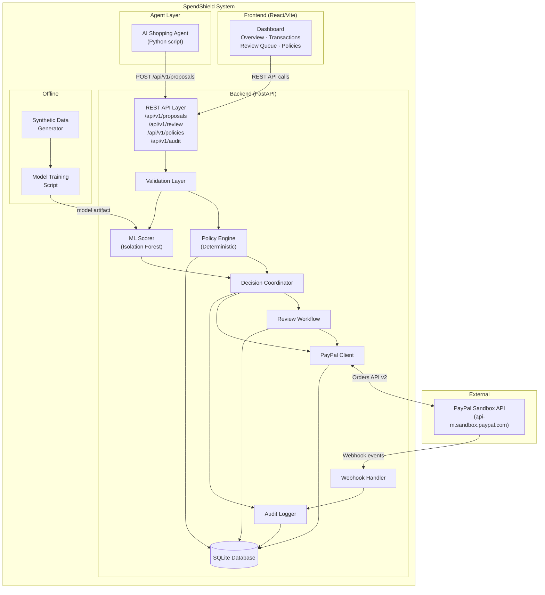
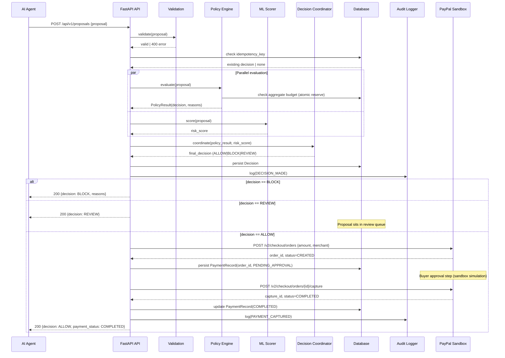
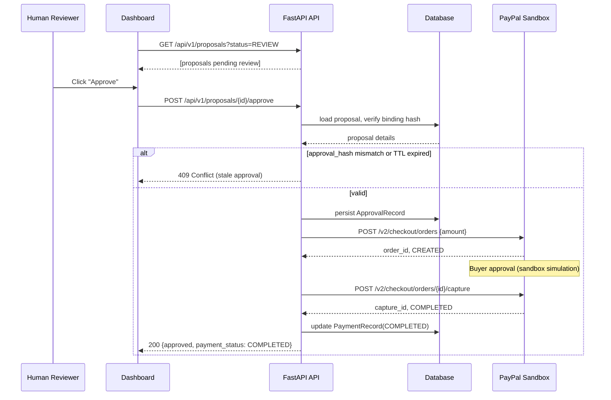

# SpendShield — Architecture

> **Document status:** Planning-phase design. No implementation files exist yet.

---

## 1. Component Responsibilities

### Frontend Dashboard (React + TypeScript + Vite)
- Renders four views: Overview, Transactions, Review Queue, Policies.
- Reads all state from the backend REST API; never holds authoritative state.
- Provides Approve and Reject actions that call backend endpoints.
- Provides a "Run Demo" trigger.
- Uses AG Grid for the Transactions table.
- Lives in `frontend/`.

### AI Shopping Agent (Python script)
- A controlled Python script that simulates a shopping agent proposing purchases.
- Submits proposals to `POST /api/v1/proposals` only. It has no direct PayPal credentials and cannot call PayPal APIs.
- For the demo, the agent is driven by the demo runner endpoint rather than an LLM.
- Lives in `agent/`.

### FastAPI Backend
- Single-process Python application (Uvicorn + FastAPI).
- The authority for all security evaluation, approval state, payment execution, and audit logging.
- All trust decisions are made here. The agent cannot bypass this layer.
- Lives in `backend/`.

### Transaction Proposal and Validation Layer
- Validates incoming proposal fields: required fields, type safety, currency format, amount bounds, idempotency key.
- Rejects structurally invalid proposals with 400 before any policy evaluation.
- Module: `backend/app/validation.py`.

### Policy Engine
- Deterministic. Produces a hard BLOCK for any rule violation. No ML signal can override it.
- Rules evaluated in precedence order:
  1. Duplicate/idempotency check.
  2. Currency and amount format validation.
  3. Per-transaction cap.
  4. Rolling-window aggregate cap (budget reservation, atomic).
  5. Merchant block list.
  6. Merchant trust level (known vs. unknown).
- Returns `PolicyResult(decision, reasons: List[str])`.
- Module: `backend/app/policy/engine.py`.

### ML Risk-Scoring Service
- Loads a pre-trained Isolation Forest model at startup.
- Extracts a feature vector from the proposal and returns a normalised risk score [0.0, 1.0].
- Higher score = more anomalous.
- A score above `REVIEW_THRESHOLD` (configurable, default 0.7) may trigger REVIEW.
- If the model file is missing or inference raises an exception, returns score = 0.5 and logs a warning. The policy engine result is preserved.
- Module: `backend/app/ml/scorer.py`.

### Decision Coordinator
- Applies the combined decision logic:
  1. If `PolicyResult.decision == BLOCK` → final decision = BLOCK (ML score irrelevant).
  2. If `PolicyResult.decision == ALLOW` and `ml_score >= REVIEW_THRESHOLD` → final decision = REVIEW.
  3. If `PolicyResult.decision == ALLOW` and `ml_score < REVIEW_THRESHOLD` → final decision = ALLOW.
- Records the final decision, reasons, and model/policy versions in the database.
- Module: `backend/app/decision.py`.

### Human Approval Workflow
- Manages the REVIEW queue.
- Approval is bound to a hash of `sha256(proposal_id + amount + currency + merchant_id)`.
- Approval has a configurable TTL (default: 30 minutes).
- On approval: verifies binding hash, checks TTL, then proceeds to PayPal order creation.
- On rejection or TTL expiry: releases any budget reservation.
- Module: `backend/app/review.py`.

### PayPal Orders API Integration
- Handles OAuth2 client-credentials token acquisition and refresh.
- Wraps three PayPal endpoints:
  - `POST https://api-m.sandbox.paypal.com/v2/checkout/orders` — create order.
  - `POST https://api-m.sandbox.paypal.com/v2/checkout/orders/{id}/capture` — capture payment.
  - `GET  https://api-m.sandbox.paypal.com/v2/checkout/orders/{id}` — poll order status.
- Stores `paypal_order_id`, `paypal_capture_id`, `paypal_status` in `PaymentRecord`.
- Sandbox credentials stored in environment variables, never in source code or database.
- Module: `backend/app/integrations/paypal.py`.

### Payment Status and Webhook Processing
- `POST /api/v1/webhooks/paypal` receives PayPal event notifications.
- Verifies webhook signature using PayPal's verify-webhook-signature API (`POST https://api-m.sandbox.paypal.com/v1/notifications/verify-webhook-signature`).
- Handles `PAYMENT.CAPTURE.COMPLETED` and `PAYMENT.CAPTURE.DENIED` events.
- Updates `PaymentRecord.payment_status` and appends an audit event.
- Unverified or replayed webhook events are rejected with 400.
- Module: `backend/app/webhooks.py`.

### Persistence Layer
- SQLite database for the hackathon. Schema defined via SQLModel (or SQLAlchemy + Alembic).
- Tables: `proposals`, `policy_rules`, `decisions`, `approval_records`, `audit_events`, `budget_ledger`, `payment_records`.
- Database file path configured via `DATABASE_URL` environment variable.
- Module: `backend/app/db/`.

### Audit Logging
- Append-only: no UPDATE or DELETE operations on `audit_events`.
- Records: proposal received, policy evaluation, ML score, decision, approval action, PayPal order created, capture result, webhook received.
- Each event includes: `event_type`, `proposal_id`, `actor` (agent/human/system), `timestamp`, `detail` (JSON).
- Module: `backend/app/audit.py`.

### Synthetic-Data Simulator and Model Evaluation Pipeline
- `scripts/generate_synthetic_data.py` generates labelled transaction records.
- `scripts/train_model.py` trains Isolation Forest and saves to `ml/models/`.
- `scripts/evaluate_model.py` runs held-out scenarios and prints metrics.
- Not invoked at runtime. Run manually by the developer.

---

## 2. Architecture Diagram



---

## 3. Principal Purchase Workflow — Sequence Diagram



---

## 4. Human Review Approval Sequence



---

## 5. Transaction States and Transitions

```
PROPOSED → [validation fails] → INVALID (terminal)
PROPOSED → [validation passes] → EVALUATING
EVALUATING → [policy BLOCK] → BLOCKED (terminal)
EVALUATING → [policy ALLOW, ML low] → ALLOWED
EVALUATING → [policy ALLOW, ML high] → REVIEW_PENDING
REVIEW_PENDING → [human approve] → ALLOWED
REVIEW_PENDING → [human reject] → REJECTED (terminal)
REVIEW_PENDING → [TTL expired] → EXPIRED (terminal)
ALLOWED → [PayPal order created] → PAYMENT_PENDING
PAYMENT_PENDING → [PayPal capture success] → PAYMENT_COMPLETED (terminal)
PAYMENT_PENDING → [PayPal capture failed] → PAYMENT_FAILED (terminal)
PAYMENT_PENDING → [PayPal order expired/abandoned] → PAYMENT_ABANDONED (terminal)
```

**Important:** `PAYMENT_PENDING` is not the same as `PAYMENT_COMPLETED`. The dashboard must never show COMPLETED until a capture with `status=COMPLETED` has been confirmed by PayPal.

---

## 6. Trust Boundaries

| Boundary | Trust level | Notes |
|---|---|---|
| Agent → Backend `/api/v1/proposals` | Untrusted | Agent identity asserted by API key; proposal fields validated but not inherently trusted |
| Backend → PayPal sandbox | Semi-trusted | HTTPS + OAuth2; responses verified; webhook signatures verified separately |
| Human → Dashboard → Backend | Trusted user action | Approval binding prevents tampering after the fact |
| PayPal webhook → Backend | Unverified until signature check | Backend must verify every webhook before acting on it |
| Audit log → Database | System-internal | Append-only; backend enforces no UPDATE/DELETE on audit_events |

The agent **cannot** hold PayPal credentials. It calls only the SpendShield API. The backend holds PayPal credentials and is the sole executor of payment operations.

---

## 7. API Overview

### Core endpoints

| Method | Path | Purpose |
|---|---|---|
| POST | /api/v1/proposals | Submit a purchase proposal |
| GET | /api/v1/proposals | List proposals (paginated, filterable) |
| GET | /api/v1/proposals/{id} | Get proposal details with decision and payment status |
| GET | /api/v1/proposals/{id}/audit | Get audit trail for one proposal |
| POST | /api/v1/proposals/{id}/approve | Human approve a REVIEW proposal |
| POST | /api/v1/proposals/{id}/reject | Human reject a REVIEW proposal |
| GET | /api/v1/audit | Get global audit log (paginated) |
| GET | /api/v1/policies | Get current policy configuration |
| PATCH | /api/v1/policies | Update policy configuration |
| POST | /api/v1/demo/run | Trigger demo scenario runner |
| GET | /api/v1/demo/status | Get demo runner status |
| POST | /api/v1/webhooks/paypal | Receive PayPal event webhooks |
| GET | /api/v1/health | Health check |

---

## 8. Persistence Model (Tables)

### proposals
`id` (UUID PK), `idempotency_key` (unique), `agent_id`, `amount` (Decimal), `currency` (ISO 4217), `merchant_id`, `merchant_name`, `merchant_category`, `description`, `request_timestamp`, `status` (enum), `policy_version`, `model_version`, `created_at`.

### decisions
`id` (UUID PK), `proposal_id` (FK), `decision` (ALLOW/BLOCK/REVIEW), `policy_reasons` (JSON), `ml_risk_score` (float), `ml_model_version`, `decided_at`.

### policy_rules
`id` (UUID PK), `rule_key` (unique), `rule_value` (JSON), `updated_at`, `updated_by`.

### approval_records
`id` (UUID PK), `proposal_id` (FK), `action` (APPROVED/REJECTED), `binding_hash` (SHA-256), `actor`, `expires_at`, `acted_at`.

### budget_ledger
`id` (UUID PK), `proposal_id` (FK), `amount` (Decimal), `currency`, `status` (RESERVED/RELEASED/CONSUMED), `window_key` (e.g., "daily:2026-10-20"), `created_at`.

### payment_records
`id` (UUID PK), `proposal_id` (FK), `paypal_order_id`, `paypal_capture_id`, `payment_status` (PENDING_APPROVAL/CAPTURED/FAILED/ABANDONED), `capture_response_raw` (JSON), `created_at`, `updated_at`.

### audit_events
`id` (UUID PK), `proposal_id` (FK, nullable), `event_type`, `actor`, `timestamp`, `detail` (JSON). NO UPDATE/DELETE permitted on this table.

---

## 9. Deployment Design

### Backend
- Python 3.11+, FastAPI, Uvicorn.
- Deploy to Render (free-tier web service, Python runtime).
- Environment variables set in Render dashboard: `DATABASE_URL`, `PAYPAL_CLIENT_ID`, `PAYPAL_CLIENT_SECRET`, `PAYPAL_WEBHOOK_ID`, `SS_API_KEY`, `ML_MODEL_PATH`, `REVIEW_THRESHOLD`.
- SQLite database lives on Render's ephemeral disk (acceptable for hackathon; data resets on redeploy).

### Frontend
- Vite + React + TypeScript, served as static assets.
- Deploy to Vercel or Netlify.
- `VITE_API_BASE_URL` points to Render backend URL.

### ML model
- Artifact `isolation_forest_v1.pkl` committed to repository in `ml/models/` (file size permitting) or fetched from a URL on startup.
- Model loading happens at application startup; unavailability is handled gracefully.

### Local development
- Backend: `uvicorn backend.app.main:app --reload --port 8000`
- Frontend: `npm run dev` (port 5173)
- Agent: `python agent/simulate.py`
- CORS configured to allow `localhost:5173` in development.
